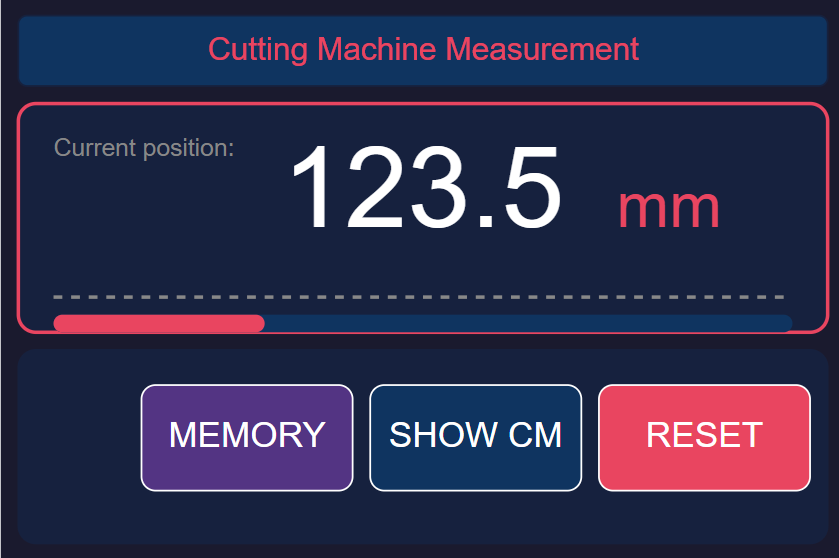
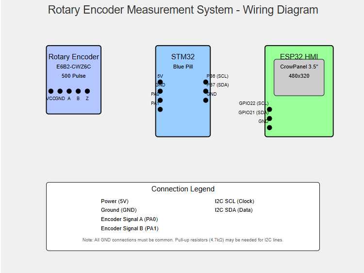

# Rotary Encoder Ruller System

A digital measurement system for cutting tables that uses a rotary encoder to track material movement with real-time display on a touchscreen interface.



## 📋 Overview

This project implements a high-precision digital measurement system for tracking material movement on cutting tables or similar applications. It combines an industrial rotary encoder with microcontroller processing and a touchscreen display to provide accurate, real-time measurements.

### 🔧 Key Components

- **Input Device**: Omron E6B2-CWZ6C 500 PPR Rotary Encoder
- **Processing Unit**: STM32F103C8T6 (Blue Pill)
- **Display System**: ESP32 with CrowPanel 3.5" HMI Touchscreen (480×320)
- **Communication**: I2C Protocol

### ✨ Features

- High-precision measurement (theoretical precision of 0.05mm)
- Real-time digital display
- Touch interface with unit switching (mm/cm)
- Zero reset functionality
- Memory function for storing measurements
- Bidirectional measurement (tracks forward and backward movement)
- Customizable calibration

## 🏗️ System Architecture

The system uses a quadrature rotary encoder connected to an STM32 microcontroller for pulse counting and distance calculation. The STM32 communicates with an ESP32 via I2C, which handles the user interface and display functionality.

### Wiring Diagram



## 🔌 Hardware Setup

### Components List

- Omron E6B2-CWZ6C 500 PPR Incremental Rotary Encoder
- STM32F103C8T6 "Blue Pill" Development Board
- ESP32 with CrowPanel 3.5" HMI Touchscreen
- Measurement wheel (customizable size, default 100mm circumference)
- Mounting hardware for encoder and wheel

### Connections

| Rotary Encoder | STM32 Blue Pill |
|----------------|-----------------|
| A Signal       | PA0 (TIM2_CH1)  |
| B Signal       | PA1 (TIM2_CH2)  |
| VCC (5-24V)    | 5V (regulated)  |
| GND            | GND             |

| STM32 Blue Pill | ESP32          |
|-----------------|----------------|
| PB6 (I2C1_SCL)  | GPIO22 (SCL)   |
| PB7 (I2C1_SDA)  | GPIO21 (SDA)   |
| GND             | GND            |

*Note: All GND connections must be common. Pull-up resistors (4.7kΩ) may be needed for I2C lines.*

## 💻 Software Implementation

### STM32 Firmware

The STM32 firmware handles:
- Hardware interrupts for encoder pulse counting
- Quadrature decoding for direction detection
- Distance calculation based on encoder resolution and wheel size
- I2C slave interface for communication with ESP32
- Calibration parameter storage

### ESP32 Software

The ESP32 software manages:
- Touchscreen interface and display
- User input processing for MEMORY, SHOW CM, and RESET buttons
- I2C master communication with STM32
- Unit conversion (mm/cm)
- Display formatting and updates

## 📱 User Interface

The user interface provides:

- Large, clear digital readout of the current position
- Unit display (mm/cm)
- Progress indicator bar
- Three touch buttons:
  - MEMORY: Store current measurement
  - SHOW CM: Toggle between mm and cm display
  - RESET: Zero the current measurement


## 📦 Repository Structure

```
├── docs/
│   ├── images/
│   │   ├── ui_preview.png
│   │   ├── wiring_diagram.png
│   │   └── system_architecture.png
│   ├── system_architecture.md
│   ├── calibration_guide.md
│   └── user_manual.md
├── stm32_firmware/
│   └── stm32_encoder_interface/
│       ├── stm32_encoder_interface.ino
│       ├── encoder.h
│       ├── encoder.cpp
│       ├── i2c_slave.h
│       ├── i2c_slave.cpp
│       └── calibration.h
├── esp32_firmware/
│   └── esp32_display_interface/
│       ├── esp32_display_interface.ino
│       ├── display.h
│       ├── display.cpp
│       ├── i2c_master.h
│       └── i2c_master.cpp
├── .gitignore
├── LICENSE
└── README.md
```

## 🚀 Getting Started

### Prerequisites

- Arduino IDE
- STM32duino package for STM32 development
- ESP32 board package
- LVGL or TFT_eSPI library for ESP32 UI

### Installation

1. Clone this repository:
   ```bash
   git clone https://github.com/yourusername/rotary-encoder-measurement-system.git
   ```

2. Open the STM32 firmware sketch in Arduino IDE:
   ```bash
   arduino stm32_firmware/stm32_encoder_interface/stm32_encoder_interface.ino
   ```

3. Install required libraries using the Arduino Library Manager
   - For STM32: STM32duino, Wire
   - For ESP32: TFT_eSPI, Wire, SPI

4. Compile and upload the STM32 firmware to your Blue Pill board

5. Open the ESP32 firmware sketch:
   ```bash
   arduino esp32_firmware/esp32_display_interface/esp32_display_interface.ino
   ```

6. Compile and upload the ESP32 firmware to your CrowPanel

### Calibration

For proper calibration:
1. Measure a known distance (e.g., 1000mm) using a tape measure
2. Move the system exactly this distance
3. Compare displayed value with actual distance
4. Adjust calibration factor in the STM32 code

## 📊 Performance

- **Resolution**: 0.05mm theoretical precision (with 100mm wheel)
- **Refresh Rate**: 5Hz (200ms updates)
- **Measurement Range**: Unlimited (32-bit counter)
- **Direction Sensing**: Bidirectional

## 🤝 Contributing

Contributions to improve the project are welcome! Please follow these steps:

1. Fork the repository
2. Create a feature branch (`git checkout -b feature/amazing-feature`)
3. Commit your changes (`git commit -m 'Add some amazing feature'`)
4. Push to the branch (`git push origin feature/amazing-feature`)
5. Open a Pull Request

## 📜 License

This project is licensed under the MIT License - see the [LICENSE](LICENSE) file for details.

## 📬 Contact

Mert Güzelmansur

Project Link: [https://github.com/mertguzelmansur/Cutting-Machine-Ruller-Display](https://github.com/mertguzelmansur/Cutting-Machine-Ruller-Display)
